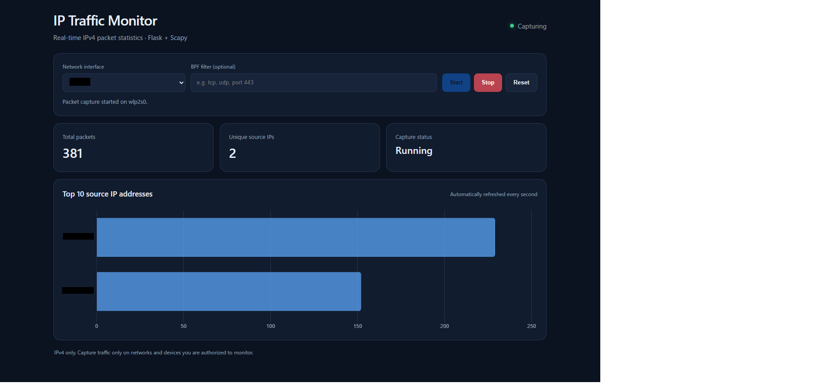

# IP Traffic Monitor Server

A lightweight browser-based IPv4 traffic monitor built with Python, Flask, and Scapy.

The application runs on Ubuntu/Linux, captures packets from a selected network interface, and displays packet counts grouped by source IP address.



## Features

- Capture IPv4 packets from a selected Linux network interface.
- Start and stop packet capture from a browser.
- Display total packet count and unique source IP count.
- Show the top 10 source IP addresses.
- Apply an optional BPF filter (`tcp`, `udp`, `port 443`, etc.).
- Refresh statistics automatically.

## Runtime Environment

- Ubuntu 22.04 LTS or later
- Python 3.10 or later
- Flask
- Scapy
- libpcap
- Modern web browser
- Chart.js (loaded from CDN)

## Project Structure

```text
ip_monitor_server/
├── app.py
├── capture.py
├── requirements.txt
├── README.md
├── README_jp.md
├── LICENSE
└── .gitignore
```

## Setup on Ubuntu

Install the system dependencies:

```bash
sudo apt update
sudo apt install -y python3-venv libpcap-dev
```

Create and activate a virtual environment:

```bash
python3 -m venv .venv
source .venv/bin/activate
```

Install Python packages:

```bash
python -m pip install --upgrade pip
python -m pip install -r requirements.txt
```

## Run

Packet capture usually requires root privileges. Run the application with the virtual environment's Python:

```bash
sudo .venv/bin/python app.py
```

Open the application on the same machine:

```text
http://127.0.0.1:5000
```

Select a network interface, optionally enter a BPF filter, and click **Start**.

## Access from Another Device

By default, the application listens only on localhost. To allow access from another device on a trusted LAN, start it with:

```bash
sudo env IPTM_HOST=0.0.0.0 .venv/bin/python app.py
```

Then open `http://<Ubuntu-server-IP>:5000` from the other device.

**Security note:** This development server has no authentication or TLS. Do not expose it directly to the public internet. Restrict access with a firewall and use a properly secured deployment setup if remote access is required.

## BPF Filter Examples

| Filter | Description |
|---|---|
| `tcp` | TCP packets |
| `udp` | UDP packets |
| `icmp` | ICMP packets |
| `port 443` | Packets using port 443 |
| `host 192.168.1.10` | Packets to or from the specified host |

An empty filter captures packets without an additional BPF restriction.

## Notes and Limitations

- The current implementation counts IPv4 packets only. IPv6 is not included.
- Packet capture requires sufficient privileges.
- BPF filters require libpcap support.
- Chart.js is loaded from a public CDN; internet access may be required to display the chart.
- The Flask development server is intended for local or trusted-LAN testing, not direct public production use.
- Capture only traffic on networks and devices you are authorized to monitor.

## License

GNU General Public License v2.0 only (GPL-2.0-only). See [LICENSE](LICENSE).

## Acknowledgements

- [Scapy](https://scapy.net/)
- [Flask](https://flask.palletsprojects.com/)
- [Chart.js](https://www.chartjs.org/)
