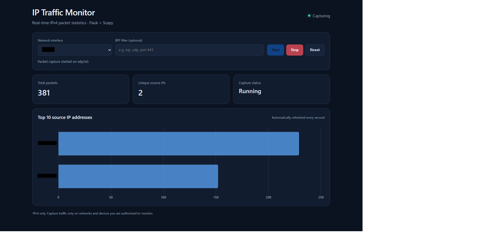

# IP Traffic Monitor Server

Python、Flask、Scapyで構築した、ブラウザベースのIPv4ネットワーク監視ツールです。

Ubuntu/Linux上でネットワークインターフェースを選択してパケットを取得し、送信元IPアドレスごとのパケット数をブラウザに表示します。



## 主な機能

- LinuxのネットワークインターフェースからIPv4パケットを取得
- ブラウザからパケット取得を開始・停止
- 総パケット数と送信元IPアドレス数を表示
- パケット数の多い送信元IPアドレス上位10件を表示
- BPFフィルターに対応（`tcp`、`udp`、`port 443` など）
- 統計情報を自動更新

## 動作環境

- Ubuntu 22.04 LTS以降
- Python 3.10以降
- Flask
- Scapy
- libpcap
- Webブラウザ
- Chart.js（CDNから読み込み）

## ファイル構成

```text
ip_monitor_server/
├── app.py
├── capture.py
├── requirements.txt
├── README.md
├── README_jp.md
├── LICENSE
└── .gitignore
```

## Ubuntuへのセットアップ

システムパッケージをインストールします。

```bash
sudo apt update
sudo apt install -y python3-venv libpcap-dev
```

仮想環境を作成して有効化します。

```bash
python3 -m venv .venv
source .venv/bin/activate
```

Pythonライブラリをインストールします。

```bash
python -m pip install --upgrade pip
python -m pip install -r requirements.txt
```

## 起動方法

パケットキャプチャには通常root権限が必要です。仮想環境のPythonを指定して起動します。

```bash
sudo .venv/bin/python app.py
```

同じマシンのブラウザから、次のURLにアクセスします。

```text
http://127.0.0.1:5000
```

ネットワークインターフェースを選択し、必要に応じてBPFフィルターを入力して **Start** をクリックします。

## 別の端末からアクセスする場合

初期設定ではlocalhostからのみアクセスできます。信頼できるLAN内の別端末からアクセスする場合は、次のように起動します。

```bash
sudo env IPTM_HOST=0.0.0.0 .venv/bin/python app.py
```

別端末のブラウザから `http://<UbuntuサーバーのIPアドレス>:5000` にアクセスします。

**セキュリティ上の注意:** このFlask開発サーバーには認証機能やTLSがありません。インターネットに直接公開しないでください。リモートアクセスする場合はファイアウォールで接続元を制限してください。

## BPFフィルターの例

| フィルター | 説明 |
|---|---|
| `tcp` | TCPパケット |
| `udp` | UDPパケット |
| `icmp` | ICMPパケット |
| `port 443` | ポート443を使用するパケット |
| `host 192.168.1.10` | 指定IPとの送受信パケット |

フィルターを空欄にすると、BPFによる追加制限なしで取得します。

## 注意事項・制限事項

- 現在の実装はIPv4パケットのみを集計します。IPv6は対象外です。
- パケットキャプチャには十分な権限が必要です。
- BPFフィルターを使用するにはlibpcapが必要です。
- グラフ表示にはCDNからChart.jsを読み込むため、インターネット接続が必要な場合があります。
- Flask開発サーバーはローカルまたは信頼できるLANでのテスト用です。本番環境としてインターネットに直接公開する用途には適しません。
- 監視する権限のあるネットワーク・端末だけを対象にしてください。

## ライセンス

GNU General Public License v2.0 only（GPL-2.0-only）。詳細は [LICENSE](LICENSE) を参照してください。

## 使用ソフトウェア

- [Scapy](https://scapy.net/)
- [Flask](https://flask.palletsprojects.com/)
- [Chart.js](https://www.chartjs.org/)
